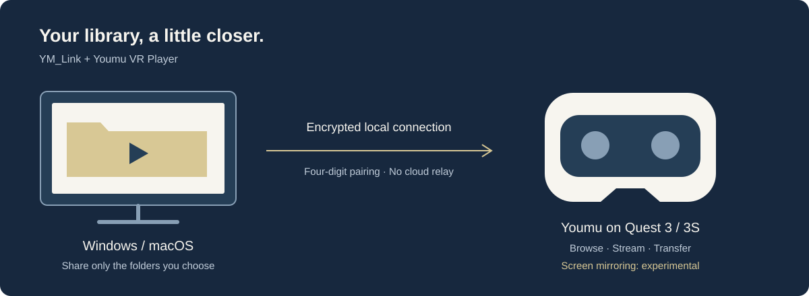

# YM_Link

**Your computer. Your Quest. One private cinema.**

The Windows and macOS desktop companion for **Youmu VR Player** on Meta Quest 3 and 3S. Bring your computer's videos into your headset over your local network.

[**Download preview**](https://youmu.forrestzhu.com/ym-link/#download) · [Setup](docs/engineering/DISTRIBUTION.md) · [简体中文](docs/README.zh-CN.md) · [Youmu VR Player](https://youmu.forrestzhu.com/en/)

## Bring your library with you

Share the folders you choose. Browse computer videos in Youmu, stream them without copying first, or transfer them to your headset for later.

## A bigger screen for your desktop

Mirror a selected display with optional system audio. Screen mirroring is experimental; real capture, Quest playback and audio synchronization are still being validated.

## Pair once. Keep it local.

Find your computer on the same network, enter a four-digit pairing code and reconnect with saved trust. Connections are encrypted; YM_Link needs no account or cloud relay.

## Get started

1. Install YM_Link on your computer and open a compatible Youmu build with **YM_Link protocol v4** on your Quest 3 or 3S. Compatibility with the current Meta Store build has not been verified.
2. Connect both devices to the same local network, open **YM_Link** in Youmu and pair with the four-digit code.
3. Add a shared folder on your computer, then browse it in your headset.

**Development preview.** Current desktop builds target Windows x64 and Apple Silicon Macs (macOS 14+). Builds are unsigned / not notarized. Intel Mac, Windows ARM64 and older target OS versions have not been validated. Use the [download guide](docs/engineering/DISTRIBUTION.md) for current builds and installation notes. See [validation status](docs/STATUS.md) for tested behavior; Quest video playback also needs further hardware validation. Youmu's access requirements apply to external media sources.

---

[Report a bug](https://github.com/forrestzhu/youmu-link/issues) · [Development guide](docs/engineering/DEVELOPMENT.md) · [Documentation](docs/README.md) · [Contributing](CONTRIBUTING.md) · [Security](SECURITY.md)

Original code: [Apache-2.0](LICENSE). [Third-party notices](THIRD_PARTY_NOTICES.md).
